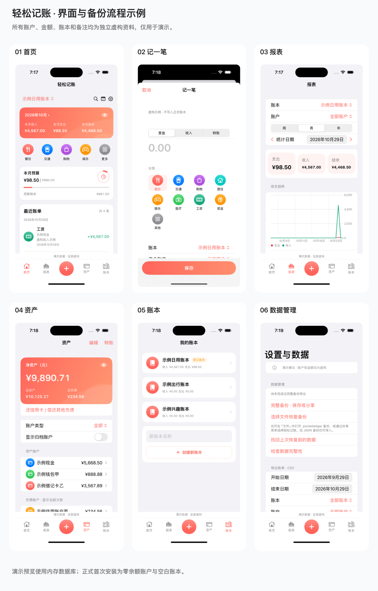
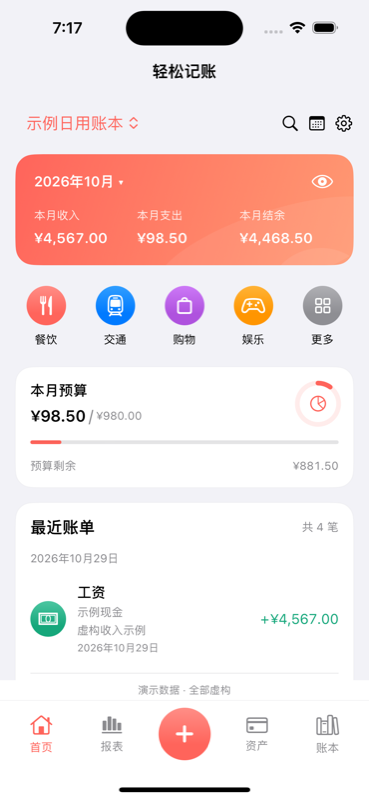
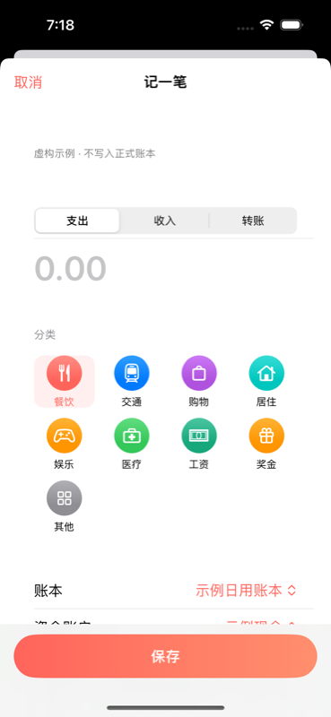
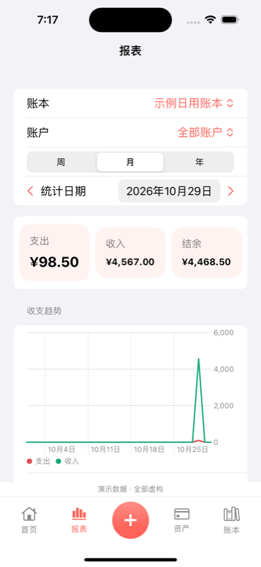
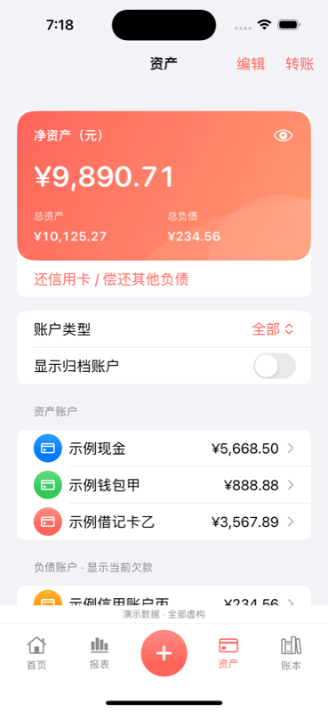
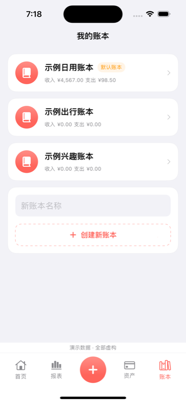
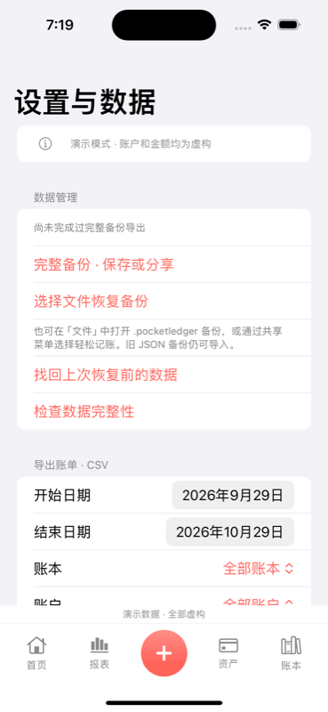

# 轻松记账 / PocketLedger

完全离线的 iPhone 记账应用。SwiftUI、Swift Charts、SQLite + GRDB，无账号、无服务器、无广告或统计 SDK。

## 界面与虚构演示数据

所有设计展示及运行截图使用独立构造的虚构数据：账户、账本均带「示例」标记，备注带「虚构」标记，固定底栏注明「演示数据 · 全部虚构」。正式首次安装仍为零余额账户和空白账本，演示资料只进入预览的内存数据库。



| 首页 | 记一笔 | 报表 |
| --- | --- | --- |
|  |  |  |

| 资产 | 账本 | 数据管理 |
| --- | --- | --- |
|  |  |  |

原始参考图及旧示例截图已从当前版本移除。新版展示板仅由以上虚构运行截图自动排版，没有使用用户提供的财务资料。

## 运行

- 最低 iOS 17，使用带有 iOS 17 或更新 SDK 的 Xcode 打开 `PocketLedger.xcodeproj`。
- 等待 SPM 解析 GRDB 6.29.3，选择 PocketLedger Scheme 和 iPhone 模拟器运行。
- 首次下载开发依赖需要联网，应用的日常功能不需要联网。
- 真机安装前，在 Signing & Capabilities 选择自己的开发团队和 Bundle Identifier。

## 已实现

- 首页、报表、资产、账本四个页面，中间加号打开快捷记账，不占第五个 Tab。
- 珊瑚橙主题、简体中文、首次引导、系统深色模式、金额隐藏和设备认证。
- 收入、支出、普通资产转账、信用卡消费、独立负债还款、借出、借入及部分还款。
- 交易详情、编辑、删除、按日分组、分页展示，按月份/日期、类型、账户、分类和备注筛选。
- 账户新增、编辑、图标、备注、是否纳入净资产、排序、归档、重新启用及空账户删除。
- 账户流水、当月资金流入流出、目标余额校正；负余额提示。
- 借贷详情、本金和还款历史、部分归还、结清、按本地日期判断逾期。
- 多账本、默认账本、归档、切换、独立收支统计和月度预算。
- 周/月/年趋势、收入/支出分类环图、排行、账户/账本筛选、分类及期间交易下钻。
- JSON 完整备份、恢复前预览、二次确认覆盖、恢复前快照和完整性校验。
- 分类排序及停用，有历史引用的分类保留名称；按日期、账本、账户筛选导出 CSV，UTF-8 BOM、两位小数和公式安全转义。
- 输入确认词并再次确认后清空全部数据；不支持合并导入。

## 资金与数据规则

金额以 Int64 分保存。账户余额由初始余额及统一过账推导，没有第二套可写余额。为了兼容最初工程，内部采用统一有符号余额：正数是资产、负数是欠款；负债界面以正数显示欠款。初始负债在创建界面输入正数，服务层转换为内部负值。

借出未收回本金属于应收资产，借入未偿还本金属于负债。转账、还信用卡、借还本金和余额校正不进入普通收支；修改账本归属不重复改变账户余额。账户归档只影响新建交易选择，不移除其资产。

SQLite 迁移从 `v1` 快照升级到 `v2-relational-postings`，并通过 `v3-account-order` 兼容排序字段，旧信用卡转账会迁移为明确的还款类型。账本、账户、交易、借贷、预算及过账均有独立表；关键关联使用外键和索引。每次业务修改在一个事务中提交，失败不发布新界面状态。数据库打开和写入在后台任务执行。

当前业务状态仍保存在内存，列表以 50 笔逐步展示，数据库更新只写变化记录；超大数据量尚未完成设备性能评估。

## iPhone 备份与恢复

- 首页齿轮 → 完整备份 → 选择「保存到文件」或「分享 / AirDrop」。可自行保存到 iCloud Drive 或传给另一台设备，应用不自动上传。
- 推荐备份扩展名为 `.pocketledger`，内容仍为完整 JSON，数据格式 v1 不变。旧 `.json` 备份仍可正常导入。
- 在「文件」中打开 `.pocketledger` 备份，或在共享菜单中选择轻松记账，会进入同一套恢复预览。普通 JSON 文件也可通过「选择文件恢复备份」导入。
- 导入先校验并显示账本、账户、交易、借贷数量，再次确认才覆盖。取消预览不修改账本；写入前保存恢复点，失败保留原数据。不支持合并导入。
- 开启设备认证时，外部打开的备份也必须解锁后才能查看预览；冷启动收到的文件会等待数据库就绪。
- CSV 可按日期、账本、账户筛选后保存或分享，UTF-8 BOM、两位小数、支持 Excel / Numbers；CSV 不用于完整恢复。
- 分享取消不更新时间，不报告成功；分享结束后清理临时文件。

JSON 包络包含 `format`、`schemaVersion`、`exportedAt`、`currency`、`appVersion`、`data`；完整保存账本、账户、分类、交易、过账、借贷、预算及设置。导入上限 50MB，校验格式、版本、ID、引用、过账和借还款金额。

完整备份和 CSV 都是明文。手动保存至 iCloud Drive 属于用户选择的系统文件操作，不是应用云同步。卸载或换机前请保管好完整备份。

## 验证

```sh
swift test
xcodebuild -project PocketLedger.xcodeproj -scheme PocketLedger -sdk iphonesimulator -configuration Debug -derivedDataPath build CODE_SIGNING_ALLOWED=NO build
python3 scripts/smoke-ios.py
```

GitHub Actions 自动运行核心测试、模拟器编译及安装启动检查。测试包括需求财务验算、跨账本一致性、编辑删除、备份校验、损坏文件、CSV、数据库重开、真实写入失败回滚、旧库迁移和两万笔数据。

当前工作环境没有 Xcode，编译结果以仓库 Actions 为准。安装启动检查不等于逐屏 UI 自动验收，仍需在真实 iPhone 上验证文件保存器、设备认证、动态字体、小屏键盘和离线全流程。

## 后续增强

分类独立收入/支出类型、改名、分类预算、备份提醒、密码加密备份、账本自定义颜色/图标、App Store 图标及商店上架材料尚未完成。不承诺已达到可直接上架标准。

GRDB 使用 MIT 许可证，详见 [第三方许可](docs/THIRD_PARTY.md)。

最近验证：20 项核心测试、iOS 模拟器编译、文件类型注册和备份预览/取消/损坏文件保留原数据自检通过。[查看验证记录](https://github.com/HAHABIN/PocketLedger/actions/runs/40833741252)。系统分享菜单已接入，AirDrop 实际收发仍需两台真机验证。
